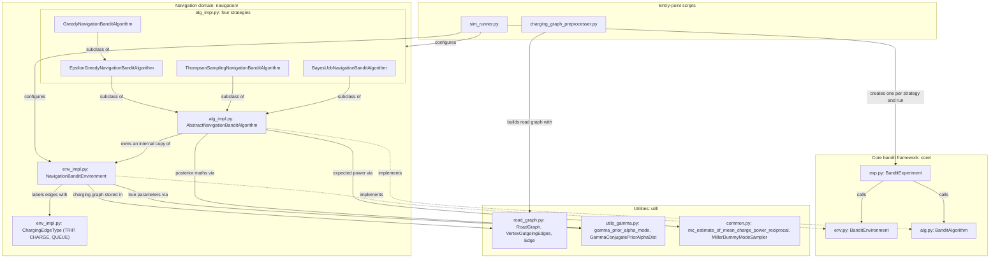
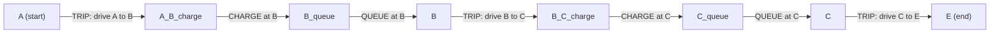

# Architecture

[Home](README.md) · [Overview](overview.md) · **Architecture** · [Data flows](data-flows.md) ·
[Algorithms](algorithms.md) · [Usage](usage.md)

## Repository layout

```
eene-nav-bandit-sim/                  repository root
├── README.md                         paper, input formats, CLI reference
├── requirements.txt                  numpy, scipy, networkx, pandas, matplotlib, pytest
├── setup.py
├── output/PLACEHOLDER                default output folder (outputs are git-ignored)
├── docs/                             this wiki
└── eene-nav-bandit-sim/              Python source (run scripts from here)
    ├── charging_graph_preprocesser.py   Phase 1 entry point
    ├── sim_runner.py                    Phase 2 entry point
    ├── core/                            generic bandit framework
    │   ├── env.py                       BanditEnvironment
    │   ├── alg.py                       BanditAlgorithm
    │   └── exp.py                       BanditExperiment
    ├── navigation/                      EV navigation domain
    │   ├── env_impl.py                  NavigationBanditEnvironment, ChargingEdgeType, QueuePrior, ChargePrior
    │   └── alg_impl.py                  AbstractNavigationBanditAlgorithm + 4 strategies
    ├── util/                            shared helpers
    │   ├── road_graph.py                RoadGraph, VertexOutgoingEdges, Edge
    │   ├── utils_gamma.py               GamCon-II prior maths, GammaConjugatePriorAlphaDist
    │   └── common.py                    mc_estimate_of_mean_charge_power_reciprocal, MillerDummyModeSampler
    └── tests/                           pytest tests with small synthetic inputs
```

Imports are top-level (for example `from core.exp import BanditExperiment`), so the scripts and tests are run from
inside the inner `eene-nav-bandit-sim/` folder.

## Two-phase pipeline

The work is split into two scripts, run one after the other:

1. **Phase 1, preprocessing** (`charging_graph_preprocesser.py`). Reads the road graph and charging station CSVs, runs
   Dijkstra's algorithm from every charging station, and saves station-to-station travel time and energy consumption
   matrices. This is the slow part (the README warns it may take hours on a large road graph) and only has to be done
   once per dataset.
2. **Phase 2, simulation** (`sim_runner.py`). Loads the matrices, builds the bandit environment and the four
   strategies, runs the experiments and writes `results.csv` and `regret_plot.png`.

Phase 2 never sees the road graph itself, only the precomputed matrices. Step-by-step detail is in
[Data flows](data-flows.md).

## Three code layers



### Layer 1: core generic bandit framework (`eene-nav-bandit-sim/core/`)

These three classes know nothing about cars or charging. They define the contract between a bandit environment and a
bandit algorithm, and the loop that connects them.

- **`env.py` `BanditEnvironment`**: interface with five methods, all `pass` in the base class:
  - `receive_feedback_for_action(iteration, action)`: random feedback for the action taken.
  - `expected_reward_for_action(iteration, action)`: true expected reward of an action (used for regret).
  - `find_best_action(iteration)`: the action with the highest expected reward.
  - `find_random_action(iteration)`: a (close to uniformly) random action.
  - `update_environment()`: called at the end of each iteration, for example to draw new random samples.
- **`alg.py` `BanditAlgorithm`**: interface with two methods:
  - `select_action(iteration)`: choose the action for this iteration.
  - `update_with_feedback(iteration, action, feedback)`: learn from the feedback.
- **`exp.py` `BanditExperiment`**: runs one algorithm against one environment.
  - The constructor takes `experiment_name`, `experiment_id`, `experiment_horizon` and two **zero-argument
    constructors**, `bandit_environment_constructor` and `bandit_algorithm_constructor`, so a fresh environment and
    algorithm are built each time the experiment runs.
  - `run_experiment()` builds both objects, computes the optimal action once with `find_best_action(1)` and its
    expected reward with `expected_reward_for_action(1, optimal_action)`, calls `update_environment()` once to draw the
    first random samples, then calls `_run_iteration` for `iteration = 1 … experiment_horizon` and returns a list of
    per-iteration dicts.
  - `_run_iteration(iteration, bandit_environment, bandit_algorithm, optimal_expected_reward)` does one step:
    1. `action = bandit_algorithm.select_action(iteration)`
    2. `feedback = bandit_environment.receive_feedback_for_action(iteration, action)`
    3. `bandit_algorithm.update_with_feedback(iteration, action, feedback)`
    4. `action_expected_reward = bandit_environment.expected_reward_for_action(iteration, action)`
    5. `instant_regret = optimal_expected_reward - action_expected_reward`
    6. `bandit_environment.update_environment()`

    It returns `{'experiment_id', 'experiment_name', 'iteration', 'instant_regret'}`.
  - `teardown()` deletes the algorithm and environment objects.

The order inside `_run_iteration` is drawn as a sequence diagram in [Data flows](data-flows.md#one-iteration-sequence-diagram).

### Layer 2: navigation domain (`eene-nav-bandit-sim/navigation/`)

#### `env_impl.py`

- **`ChargingEdgeType`** (`Enum`): `TRIP = 0`, `CHARGE = 1`, `QUEUE = 2`, the three kinds of edge in the charging graph.
- **`QueuePrior`** = `namedtuple('QueuePrior', 'a b')` and **`ChargePrior`** = `namedtuple('ChargePrior', 'ln_p q r s')`:
  prior parameters shared by all stations.
- **`NavigationBanditEnvironment(BanditEnvironment)`**. Its constructor takes the station DataFrame, the
  `charging_graph_ids.csv` DataFrame, the consumption and time matrices, `battery_capacity`, `start_node`, `end_node`,
  `queue_prior`, `charge_prior`, `min_power_factor`, `power_scale` and `rng`. It then:
  - `_create_charging_station_dictionary`: keeps only stations listed in `charging_graph_ids.csv` (raising
    `ValueError` if a station's `node_id` disagrees), and for each one draws its **true** queue and charging
    parameters with `_generate_base_action_parameters` (see [Algorithms](algorithms.md#the-simulated-world)).
  - `_create_charging_graph`: builds the charging graph as a `RoadGraph` plus a `networkx.DiGraph` copy. For every pair
    of stations `i → j` whose consumption `charging_graph_consumption[i, j] <= battery_capacity`, it adds:
    - if `j` is not the end node: a `TRIP` edge `i → "i_j_charge"`, a `CHARGE` edge `"i_j_charge" → "j_queue"` and a
      `QUEUE` edge `"j_queue" → "j"` (node names use the station `node_id`s);
    - if `j` is the end node: a single `TRIP` edge `i → j`.

    It also returns `node_idx_to_matrix_idx` (graph node → matrix row/column) and `node_idx_to_charge_origin_idx`
    (charge node → index of the station the leg started from).
  - Methods implementing the interface: `receive_feedback_for_action`, `expected_reward_for_action`,
    `find_best_action` (NetworkX `astar_path` from `start_node` to `end_node`), `find_random_action` (pick a station
    uniformly at random, then the shortest path through it) and `update_environment` (draws a new queue time and
    charging power sample for every station via `_charging_station_update`).
  - Extra method used by the algorithms: `replace_action_parameters(edge_parameters, charging_station_parameters)`
    overwrites the queue-edge weights and the per-station charging power array that the shortest-path search uses.

A route through two charging stations B and C, from start A to end E, looks like this in the charging graph:



The weight of a `CHARGE` edge is computed on the fly in `_nx_weight_function` as the consumption of the leg just
driven divided by the station's current charging power, `charging_graph_consumption_ndarray[h, j] /
charging_graph_power_ndarray[j]`: the vehicle recharges the energy it used on that leg. The A* heuristic
`_nx_astar_heuristic` is the precomputed travel time between the two stations, `charging_graph_time_ndarray[i, j]`.

#### `alg_impl.py`

- **`AbstractNavigationBanditAlgorithm(BanditAlgorithm)`**: shared state and learning. The constructor builds an
  **internal** `NavigationBanditEnvironment` (from `env_constructor`) that the algorithm uses only for its graph and
  shortest-path search, and creates per-station posterior parameters with `_create_posterior_parameter_dictionaries`.
  It implements `update_with_feedback` (Bayesian conjugate updates) and helper transforms
  `_feedback_transformation` and `_expectation_transformation`; `select_action` raises `ValueError` and is left to
  subclasses.
- **`EpsilonGreedyNavigationBanditAlgorithm`**: `_compute_posterior_modes` + `select_action`.
- **`GreedyNavigationBanditAlgorithm`**: subclass of Epsilon-Greedy with `epsilon_function=lambda t: 0.0`.
- **`ThompsonSamplingNavigationBanditAlgorithm`**: `_create_sampler`, `_generate_posterior_samples`, a sample cache,
  and an `update_with_feedback` override that resets the cache.
- **`BayesUcbNavigationBanditAlgorithm`**: `_compute_posterior_ucbs` + `select_action`.

The maths of each is in [Algorithms](algorithms.md).

### Layer 3: utilities (`eene-nav-bandit-sim/util/`)

- **`road_graph.py`**
  - `Edge(length)`: plain attribute container; other attributes (`from_node`, `to_node`, `edge_type`, `parameters`,
    `expected_weight`, `station_id`, …) are set on it by the caller.
  - `VertexOutgoingEdges(MutableMapping)`: dict-like map of outgoing edges of one vertex. `get_edge`/`set_edge`
    access the `Edge` object; `__getitem__` returns the edge's weight via the parent graph's edge weight function.
  - `RoadGraph(MutableMapping)`: dict of vertex → `VertexOutgoingEdges`. `set_edge_weight_function(fun)` picks the
    weight returned by `__getitem__` (default: `e.weight` if present, else `e.length`); `reverse()` returns a graph with
    all edges reversed. Phase 1 uses it for the road network and Phase 2 for the charging graph.
- **`utils_gamma.py`**: the conjugate prior for the parameters of a gamma distribution (called the GamCon-II
  distribution in the docstrings): `gamma_prior_alpha_lpdf`, `gamma_prior_alpha_dlpdf`, `gamma_prior_alpha_pdf`,
  `gamma_prior_alpha_dpdf`, `gamma_prior_alpha_mode` and the class `GammaConjugatePriorAlphaDist` (with the `pdf`,
  `dpdf` and `support` methods SciPy's `TransformedDensityRejection` sampler expects). See
  [Algorithms](algorithms.md#gamma-conjugate-prior-helpers-utilutils_gammapy).
- **`common.py`**: `mc_estimate_of_mean_charge_power_reciprocal` (Monte Carlo estimate of the mean of 1/power) and
  `MillerDummyModeSampler` (a stand-in sampler whose `rvs(size)` always returns a fixed mode). See
  [Algorithms](algorithms.md#monte-carlo-and-fallback-helpers-utilcommonpy).

## Tests

`eene-nav-bandit-sim/tests/` has 12 pytest tests (`test_env_impl.py`, `test_alg_impl.py`, `test_exp.py`) built on the
small synthetic inputs in `tests/utils_for_tests.py` (four stations, a 3×3 time and consumption matrix). Running them
is covered in [Usage](usage.md#running-the-tests).
