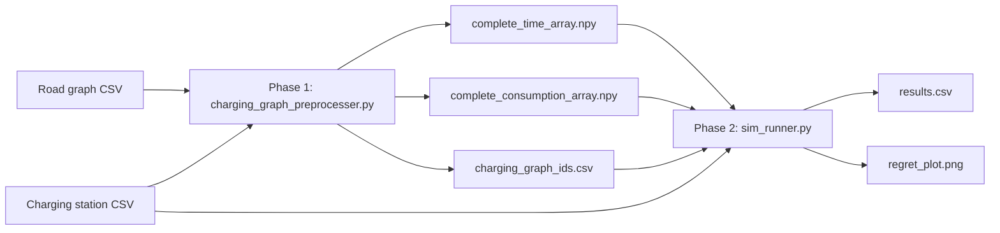
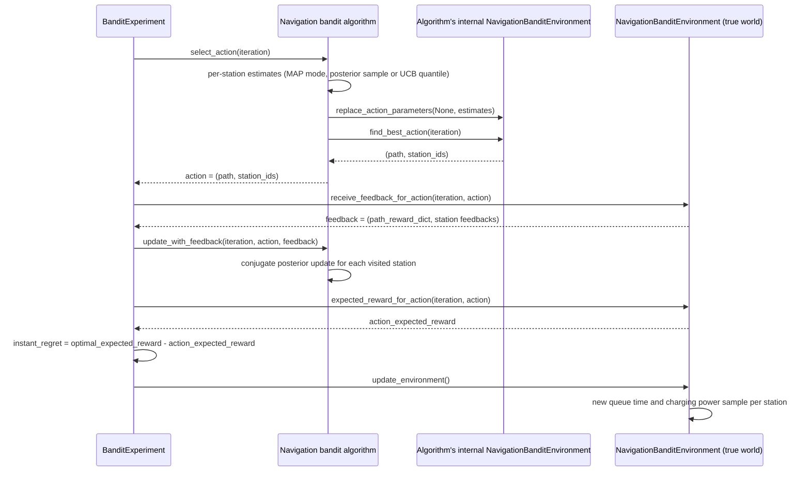

# Data flows

[Home](README.md) · [Overview](overview.md) · [Architecture](architecture.md) · **Data flows** ·
[Algorithms](algorithms.md) · [Usage](usage.md)

The simulator runs in two phases. Phase 1 turns a road network into station-to-station matrices; Phase 2 runs the
bandit experiments on those matrices.

## Phase 1: preprocessing (`charging_graph_preprocesser.py`)

**Inputs** (column formats in [Usage](usage.md#input-files)):

- `--road-graph-csv-path`: one directed edge per row with `from_id, from_y, from_x, to_id, to_y, to_x,
  mean_consumption, mean_time`.
- `--charging-station-csv-path`: one station per row with `station_id, node_id, node_y, node_x, power`.

**Steps in `main()`:**

1. Read both CSVs with `pandas.read_csv`.
2. `filter_charging_stations`: keep **one station per `node_id`**, the one with the highest `power`
   (`groupby('node_id')['power'].idxmax()`).
3. `create_graph`: build a `RoadGraph`. Each edge is an `Edge` whose weight is the two-element array
   `[mean_time, mean_consumption]`. Node IDs are converted to `str`.
4. Copy the graph into a `networkx.DiGraph` whose edge `weight` is `mean_time` only.
5. `create_charging_station_dictionary`: an `OrderedDict` of the filtered stations keyed by `str(station_id)`. Its
   order defines the matrix index of each station.
6. For every station (the "from" station):
   - `nx.dijkstra_predecessor_and_distance` from the station's `node_id`, so shortest paths are by **travel time**.
   - `add_consumption_to_distances` walks the resulting shortest-path tree (first predecessor of each node) and adds
     up `[time, consumption]` along it, giving both totals for the time-shortest path to every reachable node.
   - Fill one row of a time array and one row of a consumption array with the values for every "to" station;
     unreachable stations keep `np.inf`.
7. Stack the rows into two N×N matrices (N = number of filtered stations; row = from, column = to) and save them.

**Outputs** (written to `--output-dir`, default `../output/`):

| File | Content |
|:-----|:--------|
| `complete_time_array.npy` | N×N float array, travel time in seconds of the time-shortest path from station `i` to station `j` (`inf` if unreachable, 0 on the diagonal) |
| `complete_consumption_array.npy` | N×N float array, energy in joules used along that same path |
| `charging_graph_ids.csv` | Columns `station_id, node_id, matrix_id` (plus the unnamed pandas index column), mapping each station to its row/column in the matrices |

The output file names are concatenated directly onto `--output-dir` (`args.output_dir + 'complete_time_array.npy'`),
so the folder must end with `/`.

## Phase 2: simulation (`sim_runner.py`)

**Steps in `main()`:**

1. Parse the arguments (listed in [Usage](usage.md#phase-2-simulation-sim_runnerpy)) and configure logging.
2. **Build the priors** from the command line:
   `QueuePrior(a=--queue-prior-param-alpha0, b=--queue-prior-param-beta0)` and
   `ChargePrior(ln_p=--charge-prior-param-ln-p0, q=--charge-prior-param-q0, r=--charge-prior-param-r0, s=--charge-prior-param-s0)`.
3. **Load the data**: the station CSV and `charging_graph_ids.csv` with `pd.read_csv`, and the consumption and time
   matrices with `np.load`.
4. **Create the experiments** with `create_experiments(...)`. For each run `experiment_run = 0 … number_of_experiment_runs - 1`:
   - `env_seed = start_seed + experiment_run`
   - `agent_seed = start_seed + number_of_experiment_runs + experiment_run`
   - `env_constructor` is a `functools.partial` of `NavigationBanditEnvironment` with all data and settings except `rng`.
   - Four `BanditExperiment`s are appended, in this order and with these IDs:

     | `experiment_name` | `experiment_id` | Algorithm |
     |:------------------|:----------------|:----------|
     | `Greedy` | `4 * run` | `GreedyNavigationBanditAlgorithm` |
     | `Epsilon-Greedy` | `4 * run + 1` | `EpsilonGreedyNavigationBanditAlgorithm` with `epsilon_function=lambda t: 1. / np.sqrt(t)` |
     | `Thompson Sampling` | `4 * run + 2` | `ThompsonSamplingNavigationBanditAlgorithm` with `number_of_cached_samples=100` |
     | `BayesUCB` | `4 * run + 3` | `BayesUcbNavigationBanditAlgorithm` |

   - **Separate random number generators.** Each experiment's *environment* gets `rng=np.random.default_rng(env_seed)`.
     Each *algorithm* gets `rng=np.random.default_rng(agent_seed)`, and its internal copy of the environment (its
     `env_constructor`) gets another `np.random.default_rng(agent_seed)`. So within one run all four strategies face
     the **same** simulated world (same true station parameters, same random draws), while the algorithms' own
     randomness comes from a different seed that cannot leak information about the world.
5. **Run the experiments** one by one: `experiment.run_experiment()`, then add `cumulative_regret` (running sum of
   `instant_regret` within that experiment), append to the results, and `experiment.teardown()`.
6. **Write the outputs** to `--output-dir` (default `../output/`, must end with `/`):
   - `results.csv`: `pd.DataFrame(results).to_csv(...)`, columns: unnamed index, `experiment_id`, `experiment_name`,
     `iteration`, `instant_regret`, `cumulative_regret`.
   - `regret_plot.png`: from `create_regret_plot`, which groups by `experiment_name` and `iteration`, and plots the mean
     cumulative regret over runs with a shaded ±1 standard deviation band (title "Cumulative Regret", x axis "Time
     Step", y axis "Regret", 300 dpi).

### Inside one experiment

`BanditExperiment.run_experiment()` (in `core/exp.py`):

1. Calls the environment constructor. `NavigationBanditEnvironment.__init__` draws each station's **true** parameters
   with the environment RNG and builds the charging graph (see [Architecture](architecture.md#env_implpy)).
2. Calls the algorithm constructor. `AbstractNavigationBanditAlgorithm.__init__` builds its internal environment and
   sets every station's posterior to the prior.
3. `optimal_action = find_best_action(1)` and `optimal_expected_reward = expected_reward_for_action(1, optimal_action)`,
   using the true expected weights. This optimum is computed **once** and reused for every iteration.
4. `update_environment()` once, to draw the first queue-time and charging-power samples.
5. `_run_iteration` for each iteration, as below.

### One iteration: sequence diagram

For Epsilon-Greedy, when the random draw is below epsilon, `select_action` instead calls `find_random_action` on the
internal environment and skips the estimate step.

### What the feedback looks like

`receive_feedback_for_action` walks the path edge by edge and returns a two-element tuple:

1. `path_reward_dict`: a dict of dicts `{from_node: {to_node: -time}}` for every edge on the path. `TRIP` edges give
   their fixed expected travel time; `QUEUE` edges give the station's current `queue_time_sample`; `CHARGE` edges give
   `mean_consumption / charging_power_sample` for the leg just driven.
2. A list, in the order of `station_ids`, of `[-queue_time, -charging_time]` for each visited station.

All times are negated (rewards). The algorithms only use the second element. Driving times are deterministic in this
simulator; only queue and charging times are random.

`expected_reward_for_action` returns minus the sum of each edge's **true** expected time: `mean_time` for `TRIP`,
`1 / queue_lambda` for `QUEUE`, and `mean_consumption / charging_power` for `CHARGE`, where `charging_power` is the
station's true expected power fixed at construction.

## Reproducibility note

The NumPy generators above are seeded, but the SciPy `TransformedDensityRejection` samplers (in
`NavigationBanditEnvironment._generate_base_action_parameters` and
`ThompsonSamplingNavigationBanditAlgorithm._create_sampler`) are created without a `random_state` argument. They
therefore draw from NumPy's global random state, which `sim_runner.py` never seeds, so two runs with the same
`--start-seed` give different `results.csv` files. Calling `np.random.seed(...)` before `main()` (for example from a
small wrapper script) makes runs repeatable.
