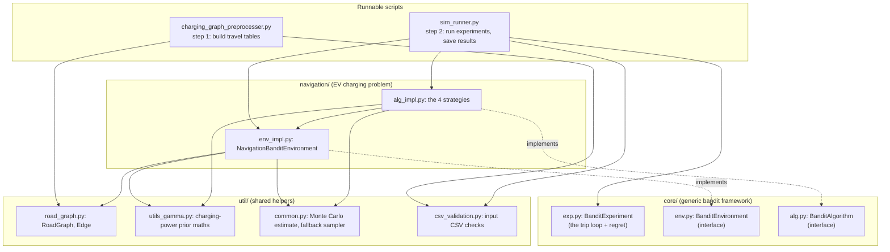
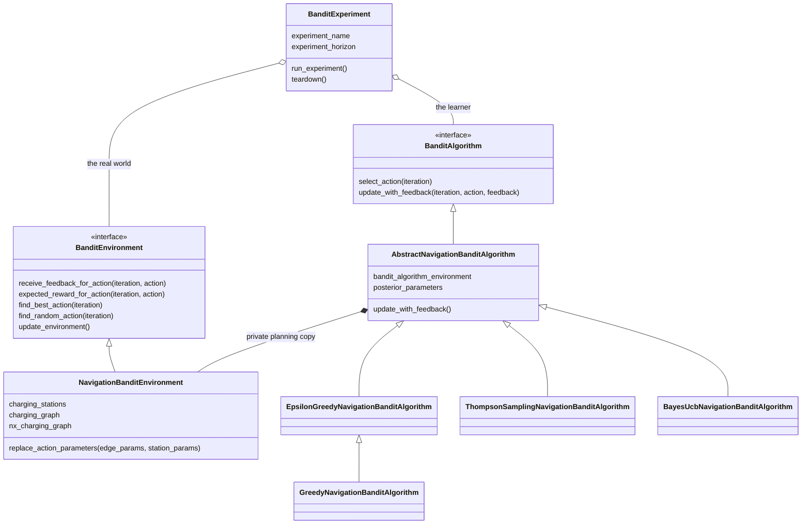
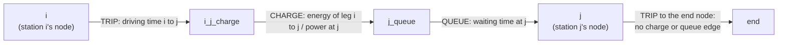

# Architecture

[Home](Home.md) · **Architecture** · [Dependencies](Dependencies.md) · [Data flow](Data-flow.md)

## The three layers

The code is split into a generic layer, a problem-specific layer and shared helpers. The two runnable scripts sit on top.

| Layer | Knows about EVs? | Role |
|-------|------------------|------|
| `core/` | No | Defines what an *environment* and an *algorithm* must be able to do, and runs the loop between them. It could be reused for any bandit problem. |
| `navigation/` | Yes | Fills in those interfaces for EV trips: the world of roads, stations, queues and chargers, plus the four strategies. |
| `util/` | Partly | A dictionary-based graph structure, the maths for the charging-power prior (a "GamCon-II" distribution), and two small sampling helpers. |

## Main classes

### `core/`
- **`BanditExperiment`** (`core/exp.py`) receives two zero-argument "constructor" functions, one for the environment and one for the algorithm, so that every experiment starts fresh.
  - `run_experiment()` first asks the environment for the best route and remembers its expected reward.
  - It then repeats one trip per iteration (see [Data flow](Data-flow.md#what-happens-on-each-trip)).
- **`BanditEnvironment`** and **`BanditAlgorithm`** (`core/env.py`, `core/alg.py`) are interfaces only. Their methods contain just `pass`.

### `navigation/env_impl.py`
- **`NavigationBanditEnvironment`** is the simulated world.
  - When it is created, it draws hidden "true" values for each station from the priors: a queue-time rate and a charging-power distribution.
  - It builds the charging graph (below) and finds shortest routes with NetworkX's A\* search.
  - Each trip it produces random observed queue and charging times.
- **`ChargingEdgeType`** marks each graph edge as `TRIP`, `CHARGE` or `QUEUE`.
- **`QueuePrior(a, b)`** and **`ChargePrior(ln_p, q, r, s)`** are named tuples holding the prior settings. They come from `sim_runner.py` arguments.

### `navigation/alg_impl.py`: the four strategies
All four share **`AbstractNavigationBanditAlgorithm`**, which keeps a *posterior* (current beliefs) for every station and updates it after each trip:
- **Queue time**: an exponential distribution with a gamma prior on its rate. The update adds 1 to `alpha` and the observed wait to `beta`.
- **Charging power**: the shortfall below the rated power is modelled as gamma-distributed, with a GamCon-II prior. The update changes `ln_p`, `q`, `r` and `s`.

They differ only in how `select_action` turns beliefs into a route:

| Strategy | Class | How it picks a route |
|----------|-------|----------------------|
| Greedy | `GreedyNavigationBanditAlgorithm` | Always uses the most likely value (MAP estimate) of each station's queue time and power. Implemented as Epsilon-Greedy with epsilon = 0 |
| Epsilon-Greedy | `EpsilonGreedyNavigationBanditAlgorithm` | Like Greedy, but with probability epsilon (set to `1/sqrt(trip number)` in `sim_runner.py`) it takes a random detour: it picks a random station and routes via it (`find_random_action`) |
| Thompson Sampling | `ThompsonSamplingNavigationBanditAlgorithm` | Draws one random plausible value per station from the beliefs and plans with those. It uses SciPy's `TransformedDensityRejection` sampler, caches 100 samples per station and falls back to `MillerDummyModeSampler` if the sampler can't be built |
| BayesUCB | `BayesUcbNavigationBanditAlgorithm` | Plans with optimistic values: an upper quantile `1 - 1/(trip+1)` of the beliefs, so less-visited stations look attractive |

**Important design detail:** each strategy owns a **private copy of the environment** (`bandit_algorithm_environment`).
- The copy is built from the same data, so the strategy knows the map, the leg times and energies, and each station's rated power.
- Before planning, the strategy overwrites the copy's queue times and charging powers with its own estimates (`replace_action_parameters`), then calls `find_best_action` on the copy.
- The real environment, with the hidden true values, is only used to produce feedback and to score regret.

### `util/`
- **`road_graph.py`**: `RoadGraph` maps a node ID to its outgoing edges; `VertexOutgoingEdges` maps a target node ID to an `Edge`; `Edge` holds attributes such as `edge_type`, `parameters` and `expected_weight`.
- **`utils_gamma.py`**: the log-density, its derivative and the mode (found with `scipy.optimize.minimize`) of the GamCon-II distribution, plus `GammaConjugatePriorAlphaDist`, the wrapper the SciPy sampler needs.
- **`csv_validation.py`**: checks the input CSVs before the scripts do any work (required columns, blank or invalid values, duplicate station IDs, unknown nodes, start/end nodes) and returns every problem with its line number.
- **`common.py`**: `mc_estimate_of_mean_charge_power_reciprocal` estimates the average of 1/power from 1,000 random samples; `MillerDummyModeSampler` is a stand-in "sampler" that always returns one fixed value.

## The charging graph

Step 1 produces a table of driving time and energy between every pair of stations. `NavigationBanditEnvironment._create_charging_graph` turns that table into a graph in which **every way of stopping is a separate edge with a time cost**, so "best route" becomes an ordinary shortest-path search.

For each pair of stations *i* → *j* whose energy fits in the battery (`consumption[i, j] <= battery_capacity`), it adds three edges:

- Node names are built from the stations' node IDs: `<i>_<j>_charge` and `<j>_queue`.
- At each stop, the car recharges the energy it used on the leg it just drove. The charging time is computed on the fly in `_nx_weight_function`.
- Legs that need more energy than one full battery get no edges, which is how the battery limit is enforced.
- The A\* search uses the pure driving-time table as its estimate of remaining time (`_nx_astar_heuristic`).
