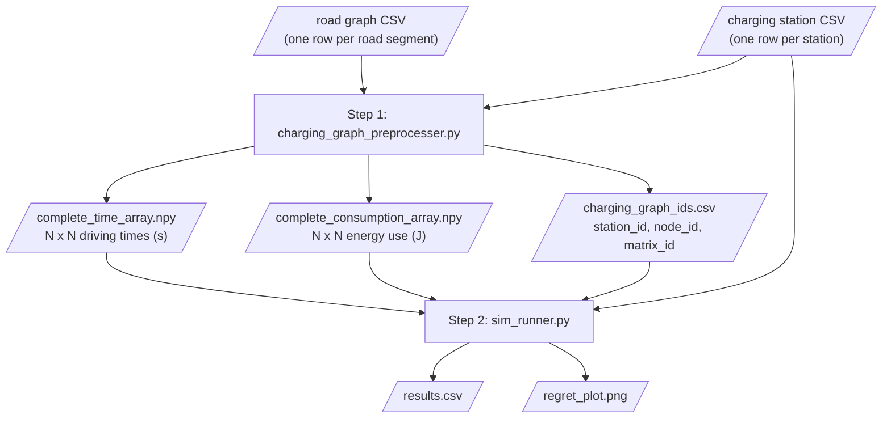
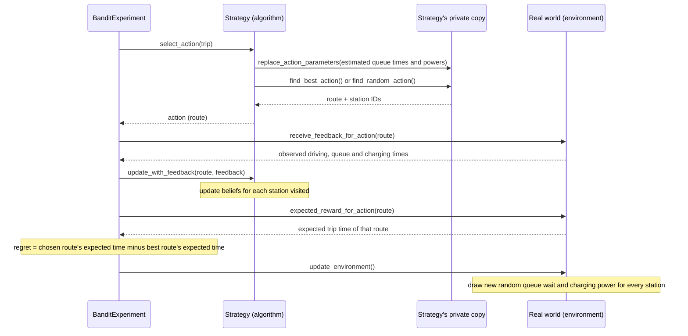

# Data flow

[Home](Home.md) · [Architecture](Architecture.md) · **Data flow**

## End to end



Step 1 is slow on real maps (the README warns it can take hours) but only needs to run once per map. Step 2 can then be re-run with different settings.

## Inputs

All units are SI: energy in **joules**, time in **seconds**, power in **watts**.

**Road graph CSV**: one row per *directed* road segment (a two-way road needs two rows):

| Column | Meaning |
|--------|---------|
| `from_id`, `to_id` | Start and end junction IDs (read as text) |
| `from_y`, `from_x`, `to_y`, `to_x` | Latitude and longitude of both ends |
| `mean_consumption` | Average energy used on the segment (J) |
| `mean_time` | Average driving time on the segment (s) |

**Charging station CSV**: one row per station:

| Column | Meaning |
|--------|---------|
| `station_id` | Unique station ID |
| `node_id` | Road junction the station sits at (must exist in the road graph) |
| `node_y`, `node_x` | Coordinates of that junction |
| `power` | Rated charging power (W) |

The start and end of the trip (`--start-node-id`, `--end-node-id`) must be the `node_id` of a station.

Every column above is required and no cell may be blank. Both scripts check this straight after reading the files (see [Input checks](#input-checks)).

## Input checks

`util/csv_validation.py` holds the lists of required columns (`ROAD_GRAPH_COLUMNS`, 8 columns; `CHARGING_STATION_COLUMNS`, 5 columns) and the check itself.
- **When it runs:**
  - step 1 checks both files;
  - step 2 checks the station file, the only CSV input it reads.
- **What it checks:** every required column is present, and no cell in those columns is blank.
- **What happens on a problem:** it collects *every* problem, then stops with one `ValueError` that names the file, the line (the header is line 1) and the column. For example:

```text
ValueError: Invalid input CSV:
  - road.csv line 10: column 'mean_consumption' is blank
  - road.csv line 11: column 'mean_time' is blank
  - stations.csv line 4: column 'power' is blank
```

or `stations.csv is missing required column 'power'`.
- **What it doesn't do:** it doesn't fill in or guess values, and it doesn't check whether numbers are sensible (e.g. `power > 0`). Correct files give exactly the same output as before.

| Problem in the file | Without the check (original code) | With the check |
|---|---|---|
| Blank `power` | step 1 crashes with `KeyError: '[nan] not in index'` | stops with the line and column |
| Blank `mean_time` | step 2 never finishes | stops in step 1 |
| Blank `mean_consumption` | wrong results with no warning: those legs disappear from the map | stops in step 1 |
| Missing column | bare `KeyError: 'power'` | names the file and the column |

Tests: `tests/test_csv_validation.py` (one bad-input test, one good-input test that runs step 1 on a tiny map).

## Step 1: preprocessing (`charging_graph_preprocesser.py`)

1. **Read and check** both CSVs: read them with pandas, then check that every required column is present and has no blank cells (`util/csv_validation.py`). Any problem stops the script before any calculation.
2. **Keep one station per junction.** `filter_charging_stations` keeps the highest-power station when several share a `node_id`. *N* = the number of stations left.
3. **Build the road graph** as a `RoadGraph`, plus a NetworkX `DiGraph` weighted by driving time.
4. **For each station:** find the *fastest* path to every junction (Dijkstra on driving time), then add up both time and energy along those paths (`add_consumption_to_distances`).
   - The energy figure is for the fastest route, not the most energy-efficient one.
5. **Fill the N x N tables.**
   - Row = from-station, column = to-station, in the order of the filtered station list.
   - Stations that can't be reached stay at infinity.
6. **Save** the two tables as `.npy` files.
   - `charging_graph_ids.csv` records which row/column (`matrix_id`) belongs to which `station_id` and `node_id`.

## Step 2: simulation (`sim_runner.py`)

1. **Read settings.**
   - Priors: `--queue-prior-param-*`, `--charge-prior-param-*`.
   - Battery capacity: default 252,000,000 J = 70 kWh.
   - Number of trips and runs, start seed.
2. **Load** the station CSV (checked the same way as in step 1), the ID CSV and both tables.
3. **Create experiments** (`create_experiments`): for each run *r*, four `BanditExperiment`s, one per strategy (IDs `4r` to `4r+3`).
   - The real world uses seed `start_seed + r`. Each strategy's private planning copy uses seed `start_seed + runs + r`.
   - So in a given run, all four strategies are meant to face the same world. Bug 11 (an unseeded sampler) means the hidden charging powers can still differ.
4. **Run each experiment** in turn. It runs `--experiment-horizon` trips (default 100).
5. **Collect results.** Add up the regret per trip into a running total, then save everything to `results.csv`.
6. **Plot** the average running total per strategy across runs, with a band of ±1 standard deviation, as `regret_plot.png`.

### Setting up one experiment

When `NavigationBanditEnvironment` is created (the real world), for every station it:
- draws a hidden **queue rate** `λ ~ Gamma(a, 1/b)`. The station's mean wait is `1/λ`.
- draws a hidden **charging-power distribution**:
  - a shape parameter from the GamCon-II prior, using SciPy's sampler;
  - a rate parameter from a gamma distribution;
  - from these two, an estimate of the station's typical power.
- builds the **charging graph** from the tables (see [Architecture](Architecture.md#the-charging-graph)).

The experiment then finds the **best possible route** using the true expected times. That route's expected time is the yardstick for regret.

### What happens on each trip



- **Observed values:**
  - Driving times are fixed: the table value.
  - Each station's queue time is random, drawn from an exponential distribution with its hidden rate.
  - Charging power is `max(min_power, rated_power - scale x g)`, where `g` is random from the station's hidden gamma distribution.
  - `min_power` = `--min-power-factor` (default 0.5) x rated power, and `scale` = `--power-scale` (default 300).
  - Charging time = energy of the leg just driven / that power.
- **Belief update:**
  - Queue: `alpha + 1`, `beta + observed wait`.
  - Charging: the observed power is turned back into a shortfall `g = (rated - observed) / scale`. Then `ln_p + ln(g)`, `q + g`, `r + 1`, `s + 1`.
- **Regret is based on expected values**, not on the random times of that trip, so luck on a single trip doesn't affect it.

## Outputs

**`results.csv`**: one row per strategy per trip per run:

| Column | Meaning |
|--------|---------|
| *(unnamed first column)* | Row number (pandas index) |
| `experiment_id` | `4 x run + strategy index` (0 Greedy, 1 Epsilon-Greedy, 2 Thompson Sampling, 3 BayesUCB) |
| `experiment_name` | Strategy name |
| `iteration` | Trip number, from 1 to the horizon |
| `instant_regret` | Extra expected time of this trip's route over the best route (s) |
| `cumulative_regret` | Running total of `instant_regret` within that run (s) |

**`regret_plot.png`**: one line per strategy (average across runs) with a shaded ±1 standard deviation band.
- With few runs, the band can dip below zero even though regret itself can't be negative.

## Where known issues occur

Bug numbers refer to [`docs/BUG_REPORT.md`](https://github.com/abhirishi1/eene-nav-bandit-sim/blob/devin/1791560357-bug-report/docs/BUG_REPORT.md).

| Stage | Issue |
|-------|-------|
| Inputs | **Fixed on this branch:** missing columns and blank cells are now rejected with a clear message (see [Input checks](#input-checks)). Values that are present but wrong (e.g. `power` of 0, or a `node_id` that isn't in the road graph) are still not checked |
| Starting either script | Python 3.10+ start-up (bug 2) is **fixed on this branch**. Missing required arguments give a confusing error (bug 9) |
| Saving outputs (both steps) | `--output-dir` without a trailing `/` puts files next to the folder, not inside it (bug 6) |
| Step 2, loading IDs | Numeric station IDs (e.g. `101`) crash with `KeyError` (bug 1) |
| Step 2, experiment setup | The SciPy sampler ignores the seed, so results vary between identical runs (bug 11, found later and not yet in the report) |
| Each trip, Epsilon-Greedy detours | Can loop forever if no detour station is reachable (bug 3). Start and end stations aren't reliably excluded (bug 5). No test covers this (bug 7) |
| Each trip, belief update | A leg with zero or negative energy breaks that station's charging-power belief for good (`ln(0)`; bug 4) |
| Charging-time error path | The error message itself crashes (bug 8). A blank `power` used to reach it; the input check now stops that earlier |
| Unused code | `VertexOutgoingEdges.__setitem__` is broken but never called (bug 10) |
