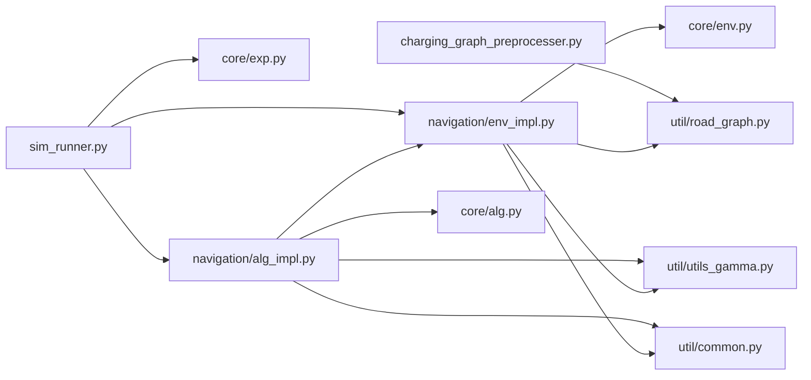

# Dependencies

[Home](Home.md) · [Architecture](Architecture.md) · **Dependencies** · [Data flow](Data-flow.md)

## Outside libraries

`requirements.txt` pins them with `~=` ("compatible release"). For example, `numpy~=1.26.2` allows any 1.26.x from 1.26.2 up, but not 1.27 or 2.x.

| Library | Pin | What the code uses it for | Where |
|---------|-----|---------------------------|-------|
| NumPy | `~=1.26.2` | Arrays (the travel tables saved as `.npy`), all random number generation (`np.random.default_rng`), gamma/exponential draws | everywhere |
| SciPy | `~=1.11.3` | `stats.sampling.TransformedDensityRejection` (sampling the charging-power prior), `stats.gamma.ppf` (BayesUCB quantiles), `special.gammaln`/`digamma` and `optimize.minimize` (prior maths and its mode) | `navigation/`, `util/utils_gamma.py` |
| NetworkX | `~=3.2.1` | `dijkstra_predecessor_and_distance` (shortest driving-time paths in step 1), `DiGraph` + `astar_path` (best route through the charging graph in step 2) | `charging_graph_preprocesser.py`, `navigation/env_impl.py` |
| pandas | `~=2.1.3` | Reading the input CSVs; collecting and writing `results.csv`; grouping results for the chart | both scripts, `navigation/env_impl.py` |
| Matplotlib | `~=3.8.1` | Drawing `regret_plot.png` | `sim_runner.py` only |
| pytest | `~=7.4.3` | Running the 12 tests (not used by the simulator itself) | `tests/` |

From Python's standard library the code uses `argparse`, `logging`, `collections`, `enum`, `functools.partial` and `typing`.

Two things to know about these files:
- `setup.py` has no `install_requires`, so `pip install .` does **not** install these libraries. Use `pip install -r requirements.txt`.
- The README's dependency table lists the ranges the authors tested (e.g. NumPy 1.24.2 to 1.26.2). The pins above are the newest of those.

## Internal module dependencies

Which file imports which (arrows point to what is imported). There are no circular imports.

- `core/` imports nothing from the project, so it is independent of the EV problem.
- The two scripts share no code; `charging_graph_preprocesser.py` only needs `util/road_graph.py`.
- Imports are written relative to the inner `eene-nav-bandit-sim/` folder (e.g. `from core.exp import ...`). That is why the scripts and tests must be run from that folder.

## Python versions

The project was developed with Python 3.9. This branch supports **Python 3.9 to 3.12**:

- `setup.py` sets `python_requires=">=3.9,<3.13"`, so `pip install .` refuses unsupported versions up front.
- `.python-version` (repository root) contains `3.12`, which tools such as pyenv and uv use to pick the interpreter.

Results of installing the exact pinned versions and running the 12 tests on each Python version:

| Python | Security support | Installs? | Tests (original `baseline` code) | Tests (this branch) |
|--------|------------------|-----------|--------------------|--------------------------------------|
| 3.9 | ended Oct 2025 | yes | 12 pass | 12 pass |
| 3.10 | ended Oct 2026 | yes | **fail to start** | 12 pass |
| 3.11 | until Oct 2027 | yes | **fail to start** | 12 pass |
| 3.12 | until Oct 2028 | yes | **fail to start** | 12 pass |
| 3.13 | until Oct 2029 | **no**: SciPy 1.11 won't build | n/a | n/a |

- **Why 3.10+ fails:** `util/road_graph.py` uses `from collections import MutableMapping`, which Python removed in 3.10. This branch changes it to `collections.abc`, which works on 3.9 too and gives identical simulation results (bug 2 in the bug report).
- **Upgrading past 3.12** would need newer SciPy (and likely NumPy) versions, which could slightly change the numbers.

## Dependency risks

| Risk | Impact | Detail |
|------|--------|--------|
| pytest 7.4.4 has a known vulnerability ([CVE-2025-71176](https://nvd.nist.gov/vuln/detail/CVE-2025-71176)) | Low: affects only test runs on a shared Unix machine | Fixed in pytest 9.0.3, which needs Python 3.10+ |
| NumPy 2.x | Blocks a future upgrade | `util/common.py` converts a 1-element array to `float`, which NumPy 1.26 warns about and NumPy 2.x is expected to reject |
| SciPy sampler ignores the seed | Results are not repeatable | `TransformedDensityRejection` is created without the seeded random generator, so `--start-seed` doesn't fully control results (bug 11) |
| No other known vulnerabilities | n/a | NumPy, SciPy, NetworkX, pandas and Matplotlib at the pinned versions had no `pip-audit` findings |
