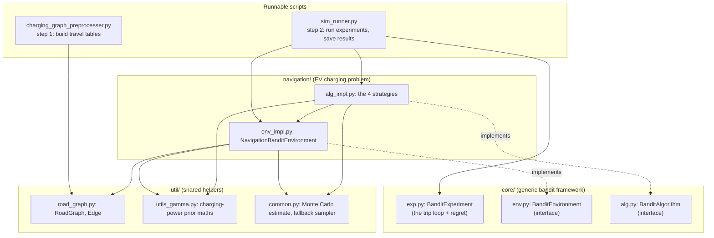
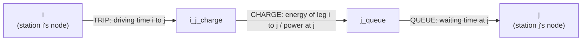
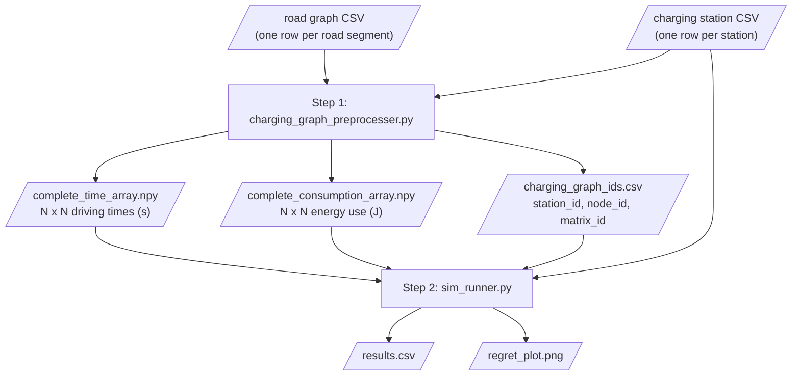
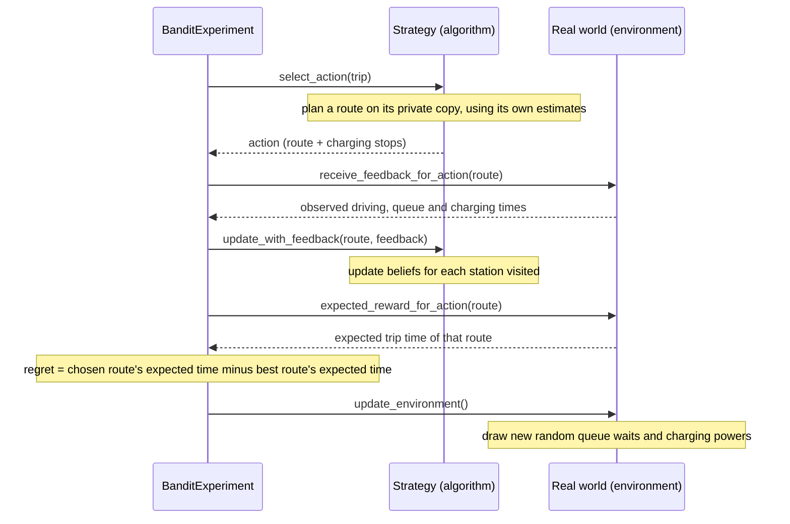

# EENE Navigation Bandit Simulator: Wiki

This is research code from Volvo Cars for the paper *"A Combinatorial Semi-Bandit Approach to Charging Station Selection for Electric Vehicles"* (Åkerblom & Haghir Chehreghani, TMLR 2023).
It studies how an electric car can **learn which charging stations to use on a long trip** when it doesn't know in advance how fast each charger really is or how long the queue will be.

The car makes the same trip many times. On each trip it picks a route with charging stops, sees how long everything actually took, and updates what it believes about the stations it used.
Four learning strategies are compared by their **regret**: the extra trip time their choices cost compared with an all-knowing planner.

This page describes the original code (the `baseline` tag) plus one change on this branch: **Python 3.10–3.12 support** (see [Dependencies](#dependencies)).

**Contents:** [Folder map](#folder-map) · [Quick start](#quick-start) · [Architecture](#architecture) · [Dependencies](#dependencies) · [Data flow](#data-flow) · [Key terms](#key-terms) · [Known issues](#known-issues)

## Folder map

```text
eene-nav-bandit-sim/                  repository root
├── README.md                         original usage guide (inputs, arguments, defaults)
├── requirements.txt                  pinned library versions
├── setup.py                          package metadata (does not list dependencies)
├── output/                           default output folder (only a PLACEHOLDER file in git)
├── docs/wiki/                        this wiki
└── eene-nav-bandit-sim/              all Python code; run the scripts from this folder
    ├── charging_graph_preprocesser.py    step 1: road map + stations -> travel tables
    ├── sim_runner.py                     step 2: run the 4 strategies -> results.csv + regret_plot.png
    ├── core/          generic "learn over repeated trials" building blocks
    ├── navigation/    the EV trip world and the 4 strategies
    ├── util/          road-graph data structure, probability maths, samplers
    └── tests/         12 pytest tests
```

## Quick start

From the inner `eene-nav-bandit-sim/` folder, using **Python 3.12** (3.9–3.12 work; see [Dependencies](#dependencies)):

```bash
pip install -r ../requirements.txt
python -m pytest tests                     # 12 tests
python charging_graph_preprocesser.py --road-graph-csv-path ROAD.csv --charging-station-csv-path STATIONS.csv
python sim_runner.py --charging-station-csv-path STATIONS.csv --start-node-id START --end-node-id END
```

The repository ships no road or station data. You supply both as CSV files (formats under [Inputs](#inputs)).

## Architecture

The code is split into a generic layer, a problem-specific layer and shared helpers. The two runnable scripts sit on top.



| Layer | Knows about EVs? | Role |
|-------|------------------|------|
| `core/` | No | Defines what an *environment* and an *algorithm* must be able to do, and runs the loop between them (`BanditExperiment`). It could be reused for any bandit problem. |
| `navigation/` | Yes | Fills in those interfaces for EV trips: the world of roads, stations, queues and chargers (`NavigationBanditEnvironment`), plus the four strategies. |
| `util/` | Partly | A dictionary-based graph structure (`RoadGraph`), the maths for the charging-power prior (a "GamCon-II" distribution), and two small sampling helpers. |

### The four strategies (`navigation/alg_impl.py`)

All four share `AbstractNavigationBanditAlgorithm`, which keeps current beliefs (a *posterior*) about every station's queue time and charging power and updates them after each trip. They differ only in how they turn beliefs into a route:

| Strategy | Class | How it picks a route |
|----------|-------|----------------------|
| Greedy | `GreedyNavigationBanditAlgorithm` | Always uses the most likely value of each station's queue time and power (Epsilon-Greedy with epsilon = 0) |
| Epsilon-Greedy | `EpsilonGreedyNavigationBanditAlgorithm` | Like Greedy, but with probability `1/sqrt(trip number)` it takes a random detour via a random station |
| Thompson Sampling | `ThompsonSamplingNavigationBanditAlgorithm` | Draws one random plausible value per station from the beliefs and plans with those |
| BayesUCB | `BayesUcbNavigationBanditAlgorithm` | Plans with optimistic values (an upper quantile of the beliefs), so less-visited stations look attractive |

**Design detail:** each strategy owns a **private copy of the environment**. Before planning, it overwrites the copy's queue times and charging powers with its own estimates (`replace_action_parameters`) and finds the quickest route on the copy. The real environment, with the hidden true values, is only used to give feedback and to score regret.

### The charging graph

`NavigationBanditEnvironment._create_charging_graph` turns the station-to-station tables into a graph where **every way of stopping is an edge with a time cost**, so "best route" becomes an ordinary shortest-path search (NetworkX A\*). For each pair of stations *i* → *j* whose leg fits in the battery, it adds three edges:



Legs that need more energy than one full battery get no edges, which is how the battery limit is enforced.

## Dependencies

**Python:** the original code only says "developed using Python 3.9" in the README and enforces nothing. On this branch, `setup.py` has `python_requires='>=3.9,<3.13'` (pip refuses other versions up front) and `.python-version` says `3.12` (picked up by pyenv and uv). There's still no `pyproject.toml`, lock file or CI workflow.

| Python | Installs? | Original code | This branch |
|--------|-----------|---------------|-------------|
| 3.9 | yes | 12 tests pass | 12 tests pass |
| 3.10, 3.11, 3.12 | yes | **fail to start**: `util/road_graph.py` used `from collections import MutableMapping`, removed in Python 3.10 (bug 2) | 12 tests pass (now `collections.abc`), identical results |
| 3.13 | **no** | SciPy 1.11 won't build | refused up front by `python_requires` |

Going past 3.12 would need newer SciPy (and likely NumPy) versions. Note that new Python 3.12 virtual environments no longer include `setuptools`, so use `pip install -r requirements.txt` rather than `python setup.py`.

**Libraries** are listed only in `requirements.txt`. `setup.py` has no `install_requires`, so `pip install .` installs none of them. `~=` means "this version or a newer bug-fix release" (e.g. `numpy~=1.26.2` allows 1.26.4 but not 1.27 or 2.x).

| Library | Pin | What the code uses it for |
|---------|-----|---------------------------|
| NumPy | `~=1.26.2` | Arrays (the `.npy` travel tables) and all random numbers |
| SciPy | `~=1.11.3` | Sampling the charging-power prior, BayesUCB quantiles, prior maths |
| NetworkX | `~=3.2.1` | Shortest driving-time paths (step 1) and best route through the charging graph (step 2) |
| pandas | `~=2.1.3` | Reading the input CSVs and writing `results.csv` |
| Matplotlib | `~=3.8.1` | Drawing `regret_plot.png` |
| pytest | `~=7.4.3` | Running the tests only |

**Internal imports:** `core/` imports nothing from the project. The two scripts share no code. Imports are written relative to the inner `eene-nav-bandit-sim/` folder (e.g. `from core.exp import ...`), which is why the scripts and tests must be run from there.

## Data flow



Step 1 can be slow on real maps (the README warns it can take hours) but only needs to run once per map. Step 2 can then be re-run with different settings.

### Inputs

All units are SI: energy in **joules**, time in **seconds**, power in **watts**.

- **Road graph CSV**, one row per *directed* road segment: `from_id`, `from_y`, `from_x`, `to_id`, `to_y`, `to_x`, `mean_consumption` (J), `mean_time` (s).
- **Charging station CSV**, one row per station: `station_id`, `node_id` (the road junction it sits at), `node_y`, `node_x`, `power` (W).
- The trip's `--start-node-id` and `--end-node-id` must each be the `node_id` of a station.

### Step 1: preprocessing (`charging_graph_preprocesser.py`)

1. Read both CSVs with pandas.
2. Keep the highest-power station at each junction (`filter_charging_stations`).
3. For each station, find the *fastest* path to every junction (Dijkstra on driving time), and add up time and energy along it (`add_consumption_to_distances`).
4. Fill the N x N time and energy tables (unreachable pairs stay at infinity) and save them, plus `charging_graph_ids.csv` mapping each table row to its station.

### Step 2: simulation (`sim_runner.py`)

1. Read the settings: priors, battery capacity (default 252,000,000 J = 70 kWh), number of trips (default 100) and runs (default 5), start seed.
2. Load the station CSV, the ID CSV and both tables.
3. For each run, create four `BanditExperiment`s, one per strategy. Each builds a fresh world that draws hidden "true" queue rates and charging-power distributions for every station, then finds the best possible route as the yardstick for regret.
4. Run every experiment for the chosen number of trips (loop below).
5. Save all regret values to `results.csv` and draw the average cumulative regret per strategy (±1 standard deviation) as `regret_plot.png`.

### What happens on each trip



Regret uses **expected** times, not the random times of that trip, so luck on a single trip doesn't affect it.

### Outputs

`results.csv` has one row per strategy per trip per run, with columns `experiment_id`, `experiment_name` (strategy), `iteration` (trip number), `instant_regret` and `cumulative_regret` (seconds). `regret_plot.png` shows one line per strategy.

## Key terms

| Term | Meaning in this code |
|------|----------------------|
| **Bandit problem** | Repeatedly choosing between options with uncertain payoffs, balancing *exploring* (trying less-known options) against *exploiting* (using what looks best) |
| **Action** | One route: the graph nodes driven through, plus the charging stations stopped at |
| **Feedback** | The observed times from one trip: driving per leg, plus queue and charging time at each station used |
| **Iteration / horizon** | One trip / the number of trips per experiment (`--experiment-horizon`, default 100) |
| **Experiment run** | One full repeat of all four strategies with fresh random worlds (`--number-of-experiment-runs`, default 5) |
| **Prior / posterior** | What a strategy believes about a station before any visits / after updating with observed visits |
| **Regret** | Expected trip time of the chosen route minus that of the best route, in seconds; "cumulative regret" is the running total |

## Known issues

A list of 10 bugs with proposed fixes is in [`docs/BUG_REPORT.md`](https://github.com/abhirishi1/eene-nav-bandit-sim/blob/devin/1791560357-bug-report/docs/BUG_REPORT.md) (on its own branch). Where they occur:

| Stage | Issue |
|-------|-------|
| Inputs | No checks on the CSVs: a blank `power` crashes step 1 with a cryptic `KeyError`; a blank `mean_time` makes step 2 not finish; a blank `mean_consumption` silently gives wrong energy values (found in testing, not yet in the bug report) |
| Starting either script | Python 3.10+ won't start on the original code (bug 2; fixed on this branch). Missing required arguments give a confusing error (bug 9) |
| Saving outputs | `--output-dir` without a trailing `/` puts files next to the folder, not inside it (bug 6) |
| Step 2, loading IDs | Numeric station IDs (e.g. `101`) crash with `KeyError` (bug 1) |
| Step 2, setup | The SciPy sampler ignores the seed, so identical runs can give different results (found later, not yet in the bug report) |
| Each trip, Epsilon-Greedy | Can loop forever if no detour station is reachable (bug 3); start/end stations aren't reliably excluded (bug 5); no test covers this (bug 7) |
| Each trip, belief update | A leg with zero or negative energy breaks that station's charging-power belief (bug 4) |
| Error handling / unused code | A charging-time error message itself crashes (bug 8); `VertexOutgoingEdges.__setitem__` is broken but never called (bug 10) |
